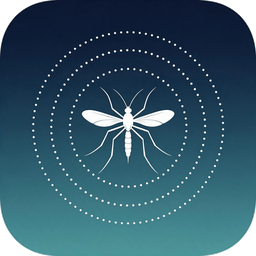

<p align="center">
  
</p>

# Mosquito Diffuser for Home Assistant

A custom integration that tracks the consumption of an anti-mosquito diffuser
cartridge from the smart plug (outlet) the diffuser is plugged into — plus an
optional built-in on/off schedule, so you don't need separate automations.

Consumption is counted **only while the outlet is on**: when the plug is off,
the clock stops. That matches how liquid refills actually deplete, regardless
of your day/night schedule.

## Features

- **Cartridge usage tracking** — exact accounting on every on→off transition
  of the outlet, with a 60 s catch-up tick. Survives restarts and downtime;
  state is persisted to `.storage`, so a month-long cartridge is not affected
  by the recorder's 10-day history purge. No recorder dependency at all.
- **One-press reset** — when you install a fresh refill, press the
  *New cartridge* button: the counter zeroes and the install date is stamped.
- **Forecasts** — remaining hours, remaining percent, and *days left at your
  measured usage pace* (with average h/day and estimated empty date).
- **Built-in schedule (optional)** — the integration itself switches the
  outlet on/off at configured times (e.g. 22:00 → 08:00), **limited to the
  months you select** (the mosquito season) so it can stay configured all
  year. A *Schedule* switch pauses it without deleting it.
- **Low-cartridge warning** — a binary sensor that turns on at a configurable
  remaining percentage.
- **Dashboard widget** — a bundled Lovelace card: cartridge gauge, days left,
  a single used/left hours bar, estimated empty date and one-tap
  reset / schedule / power actions.
- **Multiple diffusers** — each config entry is an independent device with its
  own cartridge counter.

## Entities created per instance

| Entity | Class | Description |
|---|---|---|
| `sensor.<name>_used` | sensor | Hours of active time on the current cartridge |
| `sensor.<name>_remaining_runtime` | sensor | Rated hours left |
| `sensor.<name>_remaining` | sensor | Remaining life in % |
| `sensor.<name>_days_left` | sensor | Days left at current pace (attrs: average h/day, installed at, rated life) |
| `sensor.<name>_estimated_empty` | sensor | Timestamp of the expected empty date |
| `button.<name>_new_cartridge` | button | Reset: new cartridge installed |
| `number.<name>_cartridge_level` | number | Current level in % — set it to calibrate an already-used refill |
| `switch.<name>_schedule` | switch | Pause/resume the built-in schedule (attrs: `active_months`, `in_season`, `on_time`, `off_time`) |
| `binary_sensor.<name>_low` | binary_sensor | On when remaining % ≤ threshold (`problem` class) |

## Installation

### HACS (custom repository)

1. Add this repository to HACS: *HACS → ⋮ → Custom repositories*.
2. Category **Integration**, then install **Mosquito Diffuser**.
3. Restart Home Assistant.

### Manual

Copy `custom_components/mosquito_diffuser/` into `/config/custom_components/`,
then restart Home Assistant.

## Setup

*Settings → Devices & Services → Add Integration → Mosquito Diffuser*

1. Pick the **outlet entity** (switch/light/fan/humidifier, e.g.
   `switch.artemide`), the **rated cartridge life** in hours (check the refill
   box; 360 h ≈ 45 nights × 8 h is typical), and the **low warning threshold**.
2. If you enable the schedule, choose **turn on / turn off times** and the
   **active months** — the integration switches the outlet automatically, but
   only during those months (e.g. April–October), so the configuration can
   stay in place all year. Outside the season the schedule never switches
   the outlet on; it still switches it off at the usual morning time, so a
   forgotten outlet can't run all winter. Disable your old on/off
   automations for that plug (e.g. *Camera - Antizanzare On/OFF*) to avoid
   double control.
3. When you replace the refill, press the **New cartridge** button.

> **Tip — cartridge type:** pick a preset in the setup/configuration dialog:
> **15 days (360 h)**, **1 month (720 h)**, **3 months (2,160 h)** — counted as
> continuous-use hours — or **Custom**. Custom takes either a plain total in
> *active hours*, or more naturally **days × hours per day** (e.g. 45 days at
> 8 h/day = 360 h). Since consumption only accrues while the outlet is on,
> night-rated refills should use the days + h/day form. Cartridge type is
> changed anytime under *Configure*; the measured usage counter is kept.

## Calibrating an existing cartridge

Installing the integration mid-refill? Three equivalent ways to calibrate —
all rewrite the used-hours counter from a remaining percentage:

- **Configure dialog** (Settings → Devices & services → Mosquito Diffuser →
  *Configure*): set **Current cartridge level (%)**, or tick **I just
  installed a new cartridge** to reset to 100 %.
- **Number entity** `number.<name>_cartridge_level` on the device page — also
  handy on dashboards and in automations.
- **Button** `button.<name>_new_cartridge` = reset to a fresh 100 %.

Expected duration is configured in the same dialog via **Cartridge type**
presets (15 days / 1 month / 3 months) or **Custom** = days × hours-per-day
(or a plain total in hours).

Pace note: right after calibration the forecast assumes 24 h/day use; within
a couple of days it converges to your real on/off rhythm.

## How the tracking works

- Every on→off transition charges the counter with the exact duration of the
  finished ON period.
- A 60 s tick keeps the counter fresh for long-running sessions and covers
  restarts: if Home Assistant (or the plug link) is down while the diffuser
  is on, that time is caught up on the next tick, because the diffuser really
  kept running.
- The counter is flushed to `.storage` shortly after every change and at
  shutdown, so a crash loses at most ~a minute of usage.
- Granularity note: transitions that happen entirely between two ticks are
  counted with up-to-60 s error — irrelevant for a ~700 h cartridge.

## Options

*Configure* on the integration card lets you change the name, outlet,
rated life, threshold and schedule at any time. The cartridge counter is
preserved across changes and restarts.

### Season (active months)

The schedule's **Active months** multi-select controls when the on/off
times are enforced — pick the mosquito season once and leave the
integration alone for the rest of the year:

- During the selected months the outlet is switched on/off at the
  configured times (subject to the *Schedule* pause switch).
- Outside them the schedule never switches the outlet on, and still
  switches it off at the off time (idempotent, and a safety net for a
  manually-forgotten outlet).
- Selecting no month keeps the schedule from switching the outlet on at
  any time — equivalent to leaving it paused all year.
- The `switch.<name>_schedule` entity exposes `active_months` and
  `in_season` attributes, handy for conditions in your own automations.
- On the dashboard card the subtitle shows *out of season* while the
  schedule is on hold for the month.

## Dashboard widget

The integration ships a compact **Lovelace card**: cartridge status at a
glance, with quick actions.

1. Register it as a dashboard resource once:
   *Settings → Dashboards → ⋮ → Manage resources → + Add resource*
   - URL: `/mosquito_diffuser/mosquito-diffuser-card.js`
   - Type: **JavaScript module**
2. Add it to a dashboard (a **Manual** card in the UI editor, or YAML):

```yaml
type: custom:mosquito-diffuser-card
entity: sensor.<name>_remaining
```

The card shows:

- a **vertical cartridge gauge** — a fill bar with graduation ticks,
  green / amber / red as the cartridge depletes (amber from double your
  low threshold, red at it), with the remaining percentage below;
  set `gauge: donut` for the classic ring look,
- **stat tiles** — days left plus a single **used / left** hours tile: since
  used and remaining hours are complementary (used + left = rated life), one
  bar renders both — a neutral grey segment for hours used, then runtime
  left in the gauge's green/amber/red; `stats: plain` brings back the
  classic text rows,
- the **estimated empty date**, the install date, your average h/day, the
  **schedule window** — e.g. `22:00 → 08:00 · Apr–Oct` — and a
  *Calibrate* shortcut (opens the level number entity),
- a pulsing **diffusing now** dot (the outlet state) and a red
  **low-cartridge** banner when the threshold is crossed,
- actions: **New cartridge** (press twice — it zeroes the counter), the
  **Schedule** pause/resume switch and the **outlet toggle**.

Clicking the gauge or any stat opens that entity's more-info dialog.

### Card options

| Key | Default | Description |
|---|---|---|
| `entity` | — | Any entity of this diffuser (e.g. `sensor.<name>_remaining`); siblings are auto-detected from the id |
| `name` | device name | Card title |
| `icon` | `mdi:mosquito` | Header icon |
| `gauge` | `bar` | Gauge style: vertical progress bar (`bar`) or the classic ring (`donut`) |
| `stats` | `tiles` | Hours display: tiles with a days-left bar and a split used/left bar (`tiles`) or plain text rows (`plain`) |
| `outlet_entity` | auto (from sensor attributes) | The smart plug entity |
| `days_entity`, `runtime_entity`, `used_entity`, `empty_entity`, `button_entity`, `level_entity`, `schedule_entity`, `low_entity` | auto | Explicit overrides, e.g. if you renamed the entities |

> The card is served by the integration itself from
> `custom_components/mosquito_diffuser/frontend/`, so it updates together
> with the integration — one resource entry, nothing else to keep in sync.
> Prefer a plain file? Copy `mosquito-diffuser-card.js` to `config/www/`
> and register `/local/mosquito-diffuser-card.js` instead.
>
> After installing/updating the integration, reload the dashboard page
> (hard refresh) so the browser picks up the new card script.

## Migrating from the YAML/package prototype

If you used the earlier `antizanzare_cartridge.yaml` package: remove the file
(and the `input_*` helpers it created) after installing this integration, and
disable the old *Camera - Antizanzare* automations — the schedule replaces
them.

## FAQ

- **Can one outlet feed two diffusers?** Add two entries with the same outlet
  if their refills differ; each keeps its own counter and reset.
- **The plug is a light entity.** Fine — any switch/light/fan/humidifier
  entity works; the integration toggles it in its own domain.
- **What happens at the empty date?** Nothing automatic. The *Low* binary
  sensor stays on; build a notification automation on it if you want alerts.

## Troubleshooting

- **A dialog shows a `debug_traceback` field:** that's the built-in safety net —
  the flow caught an internal error and is showing the Python traceback instead
  of failing with an opaque HTTP 500. Open an issue with its contents; the last
  `Error:` line is what matters.
- **Entities missing after an upgrade:** make sure the whole
  `custom_components/mosquito_diffuser/` folder was replaced (check `version`
  in `manifest.json`) and Home Assistant was restarted.
- **`days_left` looks off after calibrating:** it assumes 24 h/day right after
  a calibration; give it a day or two to converge to your real on/off rhythm.

## License

MIT — see [LICENSE](LICENSE).
