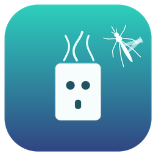

  

# Mosquito Diffuser for Home Assistant

A custom integration that tracks the consumption of an anti-mosquito diffuser
cartridge from the smart plug (outlet) the diffuser is plugged into — plus an
optional built-in on/off schedule, so you don't need separate automations.

Consumption is counted **only while the outlet is on**: when the plug is off,
the clock stops. That matches how liquid refills actually deplete, regardless
of your day/night schedule.

## Features

- **Cartridge usage tracking** — exact accounting on every on→off transition
  of the outlet, with a 60 s catch-up tick. Survives restarts and downtime;
  state is persisted to `.storage`, so a month-long cartridge is not affected
  by the recorder's 10-day history purge. No recorder dependency at all.
- **One-press reset** — when you install a fresh refill, press the
  *New cartridge* button: the counter zeroes and the install date is stamped.
- **Forecasts** — remaining hours, remaining percent, and *days left at your
  measured usage pace* (with average h/day and estimated empty date).
- **Built-in schedule (optional)** — the integration itself switches the
  outlet on/off at configured times (e.g. 22:00 → 08:00). A *Schedule* switch
  pauses it without deleting it.
- **Low-cartridge warning** — a binary sensor that turns on at a configurable
  remaining percentage.
- **Multiple diffusers** — each config entry is an independent device with its
  own cartridge counter.

## Entities created per instance

| Entity | Class | Description |
|---|---|---|
| `sensor.<name>_used` | sensor | Hours of active time on the current cartridge |
| `sensor.<name>_remaining_runtime` | sensor | Rated hours left |
| `sensor.<name>_remaining` | sensor | Remaining life in % |
| `sensor.<name>_days_left` | sensor | Days left at current pace (attrs: average h/day, installed at, rated life) |
| `sensor.<name>_estimated_empty` | sensor | Timestamp of the expected empty date |
| `button.<name>_new_cartridge` | button | Reset: new cartridge installed |
| `number.<name>_cartridge_level` | number | Current level in % — set it to calibrate an already-used refill |
| `switch.<name>_schedule` | switch | Pause/resume the built-in schedule |
| `binary_sensor.<name>_low` | binary_sensor | On when remaining % ≤ threshold (`problem` class) |

## Installation

### HACS (custom repository)

1. Add this repository to HACS: *HACS → ⋮ → Custom repositories*.
2. Category **Integration**, then install **Mosquito Diffuser**.
3. Restart Home Assistant.

### Manual

Copy `custom_components/mosquito_diffuser/` into `/config/custom_components/`,
then restart Home Assistant.

## Setup

*Settings → Devices & Services → Add Integration → Mosquito Diffuser*

1. Pick the **outlet entity** (switch/light/fan/humidifier, e.g.
   `switch.artemide`), the **rated cartridge life** in hours (check the refill
   box; 360 h ≈ 45 nights × 8 h is typical), and the **low warning threshold**.
2. If you enable the schedule, choose **turn on / turn off times** — the
   integration switches the outlet automatically. Disable your old on/off
   automations for that plug (e.g. *Camera - Antizanzare On/OFF*) to avoid
   double control.
3. When you replace the refill, press the **New cartridge** button.

> **Tip — cartridge type:** pick a preset in the setup/configuration dialog:
> **15 days (360 h)**, **1 month (720 h)**, **3 months (2,160 h)** — counted as
> continuous-use hours — or **Custom**. Custom takes either a plain total in
> *active hours*, or more naturally **days × hours per day** (e.g. 45 days at
> 8 h/day = 360 h). Since consumption only accrues while the outlet is on,
> night-rated refills should use the days + h/day form. Cartridge type is
> changed anytime under *Configure*; the measured usage counter is kept.

## Calibrating an existing cartridge

Installing the integration mid-refill? Two equivalent ways to calibrate — both
rewrite the used-hours counter from a remaining percentage:

- **Configure dialog** (Settings → Devices & services → Mosquito Diffuser →
  *Configure*): set **Current cartridge level (%)**.
- **Number entity** `number.<name>_cartridge_level` on the device page — also
  handy on dashboards and in automations.

Pace note: right after calibration the forecast assumes 24 h/day use; within
a couple of days it converges to your real on/off rhythm.

## How the tracking works

- Every on→off transition charges the counter with the exact duration of the
  finished ON period.
- A 60 s tick keeps the counter fresh for long-running sessions and covers
  restarts: if Home Assistant (or the plug link) is down while the diffuser
  is on, that time is caught up on the next tick, because the diffuser really
  kept running.
- The counter is flushed to `.storage` shortly after every change and at
  shutdown, so a crash loses at most ~a minute of usage.
- Granularity note: transitions that happen entirely between two ticks are
  counted with up-to-60 s error — irrelevant for a ~700 h cartridge.

## Options

*Configure* on the integration card lets you change the name, outlet,
rated life, threshold and schedule at any time. The cartridge counter is
preserved across changes and restarts.

## Migrating from the YAML/package prototype

If you used the earlier `antizanzare_cartridge.yaml` package: remove the file
(and the `input_*` helpers it created) after installing this integration, and
disable the old *Camera - Antizanzare* automations — the schedule replaces
them.

## FAQ

- **Can one outlet feed two diffusers?** Add two entries with the same outlet
  if their refills differ; each keeps its own counter and reset.
- **The plug is a light entity.** Fine — any switch/light/fan/humidifier
  entity works; the integration toggles it in its own domain.
- **What happens at the empty date?** Nothing automatic. The *Low* binary
  sensor stays on; build a notification automation on it if you want alerts.

## License

MIT — see [LICENSE](LICENSE).
